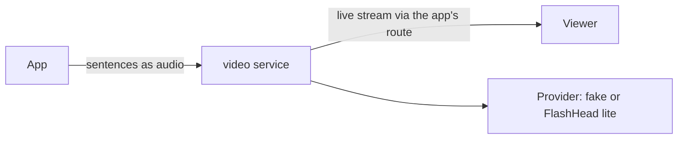

# video

A service that gives any app a live, photoreal video face for its AI agents: the
app hands it an agent's spoken sentences as audio and a few facts, and each viewer
receives one live stream of picture and sound, with the model behind it chosen by
setting. The operator starts and configures it; an app developer reads the wire.



## Quick start

From the repository root, with [uv](https://docs.astral.sh/uv/), run the service with the
`fake` provider, which draws blank frames and needs no card:

```sh
uv sync --locked --all-groups
VIDEO_PROVIDER=fake VIDEO_CONFIG_FILE=/abs/path/callers.toml uv run video-service
curl http://127.0.0.1:8080/health
```

The service listens on `127.0.0.1:8080` and answers health at once; `ready` turns true
when the start is over. The caller file `VIDEO_CONFIG_FILE` names is the form in
[`docs/configuration.md`](docs/configuration.md#caller-file).

## Where to read on

- Configure the service: [`docs/configuration.md`](docs/configuration.md) holds the settings, the look file and the caller file.
- Prove the card or watch the face live: the runbooks in [`docs/runbooks/`](docs/runbooks/).
- Call it: [`docs/wire.md`](docs/wire.md) is the wire.
- Install the client: an app depends on the Git pin the release notes give.

  ```toml
  dependencies = [
      "overnightworks-video-client @ git+https://github.com/overnightworks/video@vX.Y.Z#subdirectory=packages/client",
  ]
  ```

- Install the browser package: add the tarball the release notes name, which has no
  runtime dependency, and call `watch` as [WIRE-14](docs/wire.md#the-apps-route) says.

  ```sh
  pnpm add https://github.com/overnightworks/video/releases/download/vX.Y.Z/overnightworks-video-browser-X.Y.Z.tgz
  ```

## Release

Two workflows release, each dispatched with its version as the only input; the
[architecture overview](docs/ARCHITECTURE.md#deployment-view) says what each builds.

```sh
gh workflow run release-distributions.yml -f version=X.Y.Z
gh workflow run release.yml -f version=YYYY.MM.DD.N
```

`X.Y.Z` is the version every `pyproject.toml` and `packages/*/package.json` stands at
(`uv run --locked python scripts/check_release.py X.Y.Z` checks it); `YYYY.MM.DD.N` counts
the day's releases from 1.

## Documentation

- [`docs/VISION.md`](docs/VISION.md): what the service is for and what it is not.
- [`docs/ARCHITECTURE.md`](docs/ARCHITECTURE.md): the parts, the runtime flow and the trust model.
- [`docs/configuration.md`](docs/configuration.md): the operator's settings and files.
- [`docs/wire.md`](docs/wire.md): the wire an app calls.
- [`docs/runbooks/`](docs/runbooks/): the card proof and the live page.
- [`AGENTS.md`](AGENTS.md): the commands and rules for an agent that changes the code.
