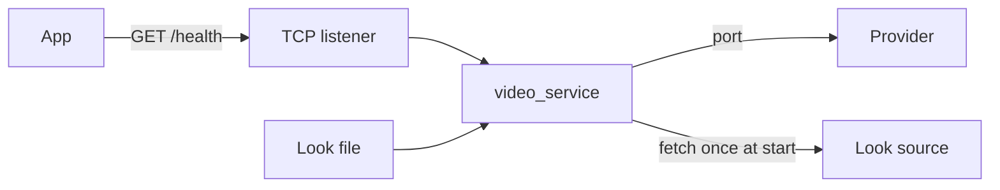

# Architecture

Audience: a developer or reviewer who needs the shape of the video service and
what it trusts.

## Purpose

One process runs one provider, a model that turns a decoded picture and, later,
sentence audio into video, and offers the looks the operator's look file names.
[`README.md`](../README.md) starts it, [`wire.md`](wire.md) holds the wire.
Providers sit behind one narrow port, so a new model never touches the service's
code. The service is built after speech: the same layout, tooling and wire
conventions, with media as the part that differs.

## Context

## Building blocks

- `src/video_service`: the one process. `__main__.py` binds the listener, serves
  health at once and loads on a daemon thread; `app.py` holds the routes and the
  refusals; `runtime.py` holds the provider, the looks and the one readiness they
  share; `looks.py` reads the look file and fetches, checks and decodes an image;
  `providers.py` is the closed catalogue `VIDEO_PROVIDER` picks from; `config.py`
  reads the settings; `card.py` reads the card's memory in use.
- `packages/client` (`overnightworks-video-client`): the one owner of the wire's
  types and the bounded health fetch. The service and its callers import them.
- `providers/provider-contract`: the port. A provider reports what it plays and
  draws when it starts, and prepares each look from a decoded image; the service
  fetches, checks and decodes every image, so a provider never touches the
  network or an untrusted file.
- `providers/fake`: a provider that holds no model. It serves the service's tests
  and a run from source, and is a development dependency no image installs.

## Looks

The look file maps a name to an image `{url, sha256}`. At start, after the
provider started, each look runs these checks in order and stops at the first that
fails: the URL lies under an allowed source and its path is plain; the fetch
succeeds without a redirect; the body is within the byte cap; its sha256 is the
file's; its header says no more than the pixel cap; it decodes as PNG, JPEG or
WebP; the provider prepares it. A look that fails stays not ready, logged as
`look_preparation.ended` with a closed `reason`, and the others serve. A provider
that fails to start leaves every look not ready and fetches none.

Nothing is fetched after the start: a look's readiness is fixed when the start
ends. The service keeps no image; what a provider prepares stays inside it.

## Failure isolation

A failed look makes that look not ready; a failed provider makes every look not
ready while health keeps answering; a provider that raises something other than
`ProviderFailedError`, or a listener that cannot bind, ends the process with a
nonzero exit.

## Trust

- The look file and `VIDEO_LOOK_SOURCES` are the operator's. The look source is
  not trusted: its bytes are bounded input (size, digest, format, pixels) and a
  redirect is never followed, so an allowed host cannot send the service to
  another.
- `GET /health` needs no token and reveals the offered look names, the provider's
  name and the card's memory in use.
- Egress: the service reaches the look sources at start and nothing else.
- Logs carry closed codes and look names, never a URL, an image or a setting's
  value.

## Delivery

CI runs lint, format and the tests with branch coverage over the service, the
client, the port and the fake provider, then the quality gate. The release
publishes the client distribution at a tag by Git pin
([README](../README.md#release)). No image exists yet.

## Proofs

Behaviour tests drive the HTTP boundary of the real app over a runtime composed
with the fake provider and a real look source on a loopback port; the process test
starts `main` and stops it with a signal. The client's tests drive `fetch_health`
against a raw listener.
