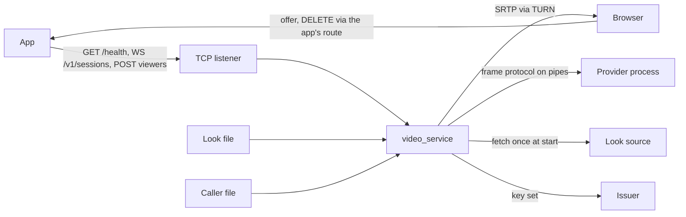
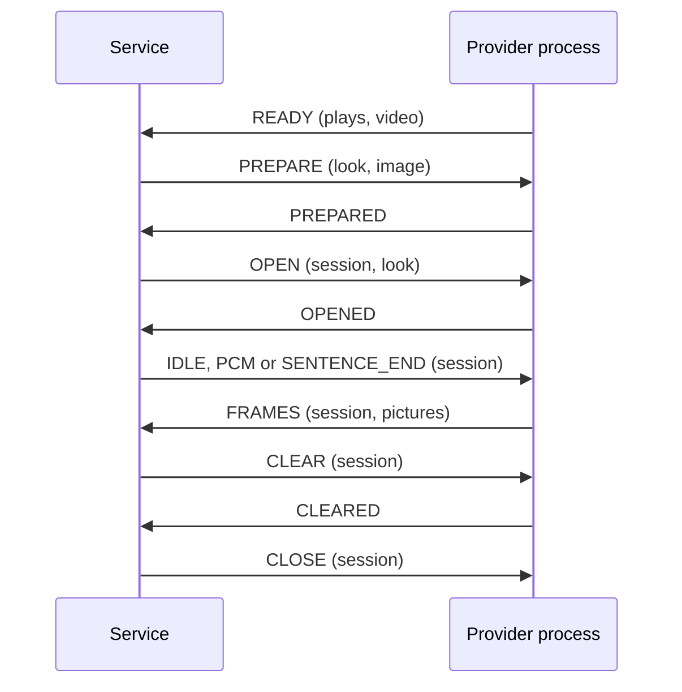

# Architecture

Audience: a developer or reviewer who needs the shape of the video service and
what it trusts.

## Purpose

One process runs one provider, a model that turns a decoded picture and sentence
audio into video, and offers the looks the operator's look file names. An app opens
a session on a look and the service plays the app's sentences on the provider's
frame clock, and the opener's viewers watch the result as one WebRTC stream.
[`README.md`](../README.md) starts it, [`wire.md`](wire.md) holds the wire.
Providers sit behind one narrow port and run in processes of their own, so a new
model never touches the service's code, and its Python and libraries need not be
the service's. The service is built after speech: the same layout, tooling and wire
conventions, with media as the part that differs.

## Context

## Building blocks

- `src/video_service`: the one process. `__main__.py` binds the listener, serves
  health at once, loads on a daemon thread and drains on a stop; `app.py` holds the
  routes and `refusals.py` the HTTP form of a refusal; `session_route.py` refuses
  or accepts a session upgrade and `session.py` is one session's state machine;
  `viewer_route.py` refuses or admits a viewer and ends one, and `media.py` holds a
  session's viewers: one aiortc peer with an Opus and a VP8 track each;
  `callers.py` proves the two tokens; `runtime.py` holds the provider, the looks,
  the one readiness they share and the places of the open sessions; `looks.py`
  reads the look file and fetches, checks and decodes an image; `providers.py` is
  the closed catalogue `VIDEO_PROVIDER` picks from and where its worker is;
  `provider_process.py` is the one `Provider` the service builds: it runs the
  worker as a child process and speaks the frame protocol; `config.py` reads the
  settings and the caller file; `card.py` reads the card's memory in use.
- `packages/client` (`overnightworks-video-client`): the one owner of the wire's
  types (health, refusals, the session's events) and the bounded health fetch. The
  service and its callers import them.
- `packages/browser` (`overnightworks-video-browser`): `watch`, the browser side of a
  viewer. A receive-only peer with the app's ICE servers, one POST of its offer to
  the app's own route, a `<video>` in the page and one signal, `loading`, `drawn`
  or `ended`, with every failure `ended`. It holds no token and has no runtime
  dependency: the app relays the offer ([WIRE-14](wire.md#the-apps-route)).
- `providers/provider-contract`: the port and the protocol. A provider reports what
  it plays and draws when it starts, prepares each look from a decoded image and
  opens a session on a look, which takes sentence audio and returns the frames each
  call draws; the service fetches, checks and decodes every image, so a provider
  never touches the network or an untrusted file, and it paces the frames, so a
  provider never keeps time. The package also owns the private frame protocol and
  the worker loop a provider's script runs, depends on no other package and runs on
  Python 3.10 and up, since a provider's environment may be older than the service's.
- `providers/fake`: a provider that holds no model. It draws blank frames on the
  audio's timeline and serves the service's tests and a run from source; its
  `video-fake-worker` runs it as a child like every provider. It is a development
  dependency no image installs.
- `providers/flashhead-lite`: the FlashHead lite model behind a renderer seam. Its
  driver turns the port's calls into slice renders; the model is upstream
  SoulX-FlashHead, bound unchanged as a git submodule at a pinned commit, since upstream
  has no package of its own: the provider's wheel carries its `flash_head` tree and
  licence beside the provider's modules, and the provider's lock pins the stack on
  Python 3.14, apart from the workspace's. One module imports upstream's inference
  module from the directory that holds the installed package, because upstream reads
  its configuration by a relative path at import. The renderer calls upstream
  through that import and keeps each look's and each session's state apart, setting
  upstream's three per-look and per-session attributes before every render; every
  number of the picture and the audio comes from upstream's parameters. The worker
  `video-flashhead-lite-worker` serves the driver over that renderer. It reads the
  card memory cap, `VIDEO_CARD_MEMORY_MB` in mebibytes, before it builds anything,
  and start refuses when no card is visible or the cap exceeds the card's total or
  free memory; otherwise it caps torch's allocator at the cap's share of the card
  before anything loads. The cap binds torch's allocator, not the card context or
  library memory. The worker goes offline for Hugging Face before importing it and
  loads weights only from `weights` beside the provider's `.venv`, which a fetch
  fills; recreating the environment keeps it. The calls that need a card live in one
  module, excluded from coverage and driven by the card proof. Its CI job checks the
  submodule out, installs the lock without building and proves, on a runner without
  a card or weights, that the import succeeds, that upstream's audio encoder returns
  its hidden states, that the real worker refuses cleanly, and that the renderer's
  state handling is right against upstream's own pipeline with tiny stand-in
  networks.

## Provider process

A provider is a child process started from its own executable, `<provider
root>/<provider>/.venv/bin/video-<provider>-worker`, or beside the service's
interpreter when no root is set; no other location is searched. The child leads a
process group of its own and inherits the service's environment. The service and the
child speak the frame protocol on the child's stdin and stdout, which the child moves
off fd 1 so a library's `print` cannot corrupt it:

A request is one call of the port, and its answer comes in request order per session,
so one child serves every open session. A CLEAR fences out the answers to the
requests sent before it. Every frame is capped from its header, before its payload
is read: the pictures from the size READY reported, an image from
`VIDEO_LOOK_MAX_PIXELS`, everything else by a small fixed bound; an unknown kind, an
oversized or truncated frame or an answer to no request is a provider failure. A
failure reaches the service as a FAILED frame with a closed code, never a message,
or as the child's exit. The child's stderr is read bounded and dropped before READY
and goes to `/dev/null` after it; it is never logged as text.

The start, a look's preparation and opening a session each have a time bound, and a
session call has `VIDEO_MAX_LAG_MS`. A bound that runs out, a child that dies or a
frame the protocol does not allow ends the child and makes the provider failed until
the service restarts; there is no restart. Health then shows the provider not ready
and every look not ready, new sessions are refused `unavailable`, and each open
session ends `unavailable`. A stop during the load ends the child without waiting for
it. The child reads its stdin on a thread of its own and ends the process on the end
of input even while the model computes, so a service that dies leaves no child.

## Media

A session owns a `Media`: the viewers its opener admitted and the frames they are fed.
Each frame the pacer lets leave (a sentence's, or the face at rest on silence)
reaches every connected viewer together with the PCM of its frame period, resampled
to 48 kHz; each viewer's peer encodes for itself with its own encoder, so a slow
viewer holds back no other, and a viewer whose encoder stalls loses its oldest
frames, not memory. Both tracks of a viewer leave in one stream under one CNAME and are
stamped from the frame count, so the browser keeps lips and sound together. The
answer offers only Opus and VP8 (libvpx is royalty-free, and VP8 costs about 0.67
cores at five viewers where H.264 costs 1.54), holds every candidate, and a viewer's
peer is built with exactly the session's ICE servers, none by default. A viewer ends
on its DELETE, on its peer's close and with its session.

## Looks

The look file maps a name to an image `{url, sha256}`. At start, after the
provider started, each look runs these checks in order and stops at the first that
fails: the URL lies under an allowed source and its path is plain; the fetch
succeeds without a redirect; the body is within the byte cap; its sha256 is the
file's; its header says no more than the pixel cap; it decodes as PNG, JPEG or
WebP; the provider prepares it. A look that fails stays not ready, logged as
`look_preparation.ended` with a closed `reason`, and the others serve. A provider
that fails to start leaves every look not ready and fetches none.

Nothing is fetched after the start: a look's readiness is fixed when the start
ends. The service keeps no image; what a provider prepares stays inside it.

## Sessions

`runtime.open_session` gives a place, or the refusal in the wire's order, and the
route accepts the upgrade on it. `session.py` then runs four tasks and ends with
the first that ends: the receive loop (events and audio in, queue and clear), the
producer, the pacer and the drain watcher. The frame clock is one grid of frame
periods: a sentence's audio sets it while it plays and the face at rest runs on it
while no sentence has audio, so the stream never stops. A frame is due one frame
period after the one before, input the client sent after the last frame had left
restarts the clock, and a frame (idle ones too) that leaves more than
`VIDEO_MAX_LAG_MS` after its time ends the session `unavailable`.

The player draws ahead of the clock so that a provider which renders in chunks
longer than a frame period serves a session without late frames, stalls or bursts.
The producer is one task that submits one provider call at a time, at most one frame
period of a sentence's audio a call, so no call takes longer than one render
however large a binary message is. It keeps the frames it gets in a buffer bounded
by `VIDEO_MAX_LAG_MS` of frames, and the pacer takes each from the buffer at its
time on the clock, so the face at rest keeps leaving while a sentence's first chunk
renders. When a sentence's first frame is in the buffer, the face at rest not yet
let go is dropped and the sentence follows; the next queued sentence is fed while
the one before still leaves, so no idle frame goes between them. Every buffered
frame carries the generation of the sentence or idle run it belongs to: a clear
bumps the generation, which discards the buffered frames and those of a call still
in flight when it returns, and the provider is asked to drop the sentence on its
own thread after that call. A chunked provider needs `VIDEO_MAX_LAG_MS` of at least
two renders and a frame period, as a clear can leave a frame waiting for the render
in flight and then the render of the face at rest.

The opening of a provider session and every call into it run on a daemon thread of
the session's own, so the provider is never entered twice and a call that never
returns holds back neither the session's end nor the process's exit: a call not back
within `VIDEO_MAX_LAG_MS` ends the session `unavailable`, and the session gives up its
place once the close of the provider session has taken that long. A session cut at
the process's exit queues the close and gives up its place without waiting for it.
The producer is cancelled and gathered before the close is queued. A sentence's
`started`, `stopped` and `cleared` are sent under one lock that also decides whether
the sentence was dropped, so no event follows its `cleared`.

## Failure isolation

A failed look makes that look not ready; a failed provider (a child that died, hung
or broke the protocol, at any time) makes every look not ready while health keeps
answering; a listener that cannot bind, or a defect in the service itself, ends the
process with a nonzero exit. A provider that raises anything inside its child fails
that provider and nothing else. A provider that fails one request of a session ends
that session `unavailable` and no other.

## Trust

- The look file and `VIDEO_LOOK_SOURCES` are the operator's. The look source is
  not trusted: its bytes are bounded input (size, digest, format, pixels) and a
  redirect is never followed, so an allowed host cannot send the service to
  another.
- The caller file is the operator's. A session needs two tokens from the configured
  issuer for the service's own audience, so a token meant for another service is
  refused; the person must be in exactly the service group and the app's group, and
  the app must be registered. The issuer's keys are fetched over https on demand;
  an issuer that cannot be reached refuses every session `unavailable`.
- The provider's code, and so any third party's, runs only in the child process, which
  holds no token and receives only decoded images and sentence audio over its pipes.
  The child inherits the service's environment; what confines it further is judged
  with each real provider.
- `GET /health` needs no token and reveals the offered look names, the provider's
  name and the card's memory in use.
- Bounded input from a caller: event JSON (closed types, bounded strings, at most
  64 KiB), PCM at a rate from a closed set, queued audio capped per session, the
  open sessions capped. A caller that breaks a bound ends its own session.
- A viewer's POST carries the session opener's two tokens, relayed by the app; the
  service runs the same check and then requires the caller's client and subject to be
  the opener's. The media is DTLS-SRTP, and an offer is bounded input (16 KiB, recvonly,
  one Opus and one VP8 section).
- No token reaches a browser. The browser package receives none and posts the offer to
  the app's route, which relays it with the session's tokens.
- Egress: the service reaches the look sources at start, the issuer's key set when it
  checks tokens and, for a viewer, the TURN servers the app hands over, and nothing
  else; the pod opens no inbound port.
- Logs carry closed codes and look names, never a URL, an image, a token, an ICE
  credential, an SDP, a candidate address or a setting's value; the `aioice` and
  `aiortc` loggers are capped above the level at which they write candidates. A session's lines join the trace its client
  events carry.

## Delivery

CI runs lint, format and the tests with branch coverage over the service, the
client, the port, the fake provider and the release script, the browser package's type check and
pack-and-install proof, the browser layer, and then the quality gate, which reads the
Python coverage and the browser layer's lcov, to which the browser package's two scripts add theirs. The release publishes the client
distribution at a tag by Git pin and the browser package as a tarball beside it
([README](../README.md#release)). No image exists yet.

## Proofs

Behaviour tests drive the HTTP and WebSocket boundary of the real app over a
runtime composed with the fake provider, a real look source on a loopback port and
a throwaway issuer that signs real tokens; the process tests start `main` and stop
it with a signal, and `serve` under a real server with a WebSocket client for the
drain; the viewer tests start `serve` on a loopback port and receive the stream with
aiortc recvonly peers, deterministic by frame timestamps. The client's tests drive `fetch_health` against a raw listener and parse the
session's events.

The browser layer drives `packages/browser` in headless Chromium against the service
from source with the fake provider and a throwaway issuer, through a stand-in app
route that relays the offer with the session's tokens. It proves what only a browser
shows: the states `show` reports, frames that advance, sound that arrives, the
offset of the heard beep to the painted flash over fifty pairs against BT.1359's
detectability window, the refusals, stop and its DELETE, the session's end, and ICE
consent expiry for a Chromium killed without a DTLS close. It collects Chromium's V8
coverage of `dist`, which a script turns into the package's lcov.
