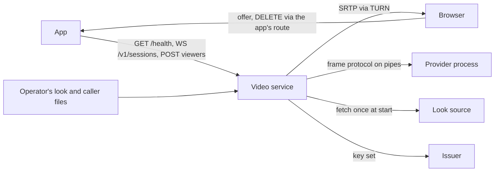
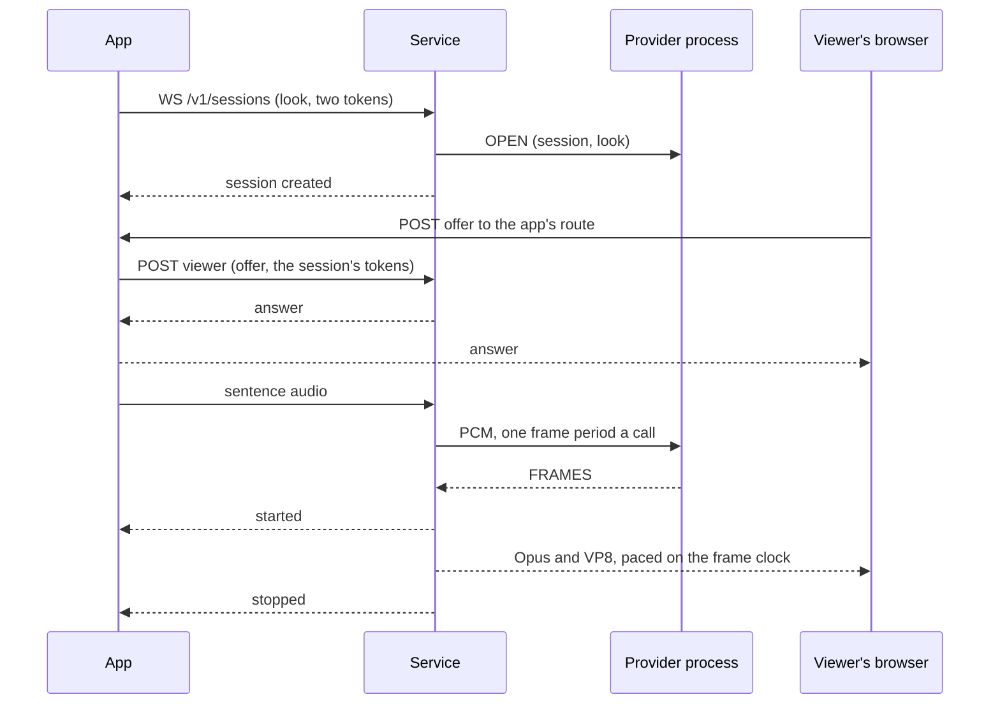

# Architecture

Audience: a developer or reviewer who needs the parts of the video service, how they
talk and what it trusts.

## Context and Scope

One process runs one provider, a model that turns a decoded picture and sentence audio
into video, and offers the looks the operator's look file names. An app opens a session on
a look; the service plays the app's sentences on the provider's frame clock, and the
opener's viewers watch the result as one WebRTC stream. The service is built after speech:
the same layout, tooling and wire conventions, with media as the part that differs.

Outside the service: the app and its browser, the issuer that signs the tokens, the look
source that hosts the images, the TURN servers the app hands over, and the operator. The
wire is [`wire.md`](wire.md); the operator's files are [`configuration.md`](configuration.md).

## Building Block View

| Part | Job |
|---|---|
| Service (`video_service`) | The one process: health, the session and viewer routes, the caller check, the looks, the sessions' frame clock and the viewers' media. |
| Client (`overnightworks-video-client`) | The one owner of the wire's types and the bounded health fetch; the service and its callers import them. |
| Browser package (`overnightworks-video-browser`) | `watch`, the browser side of a viewer: a receive-only peer that posts its offer to the app's own route and reports `loading`, `drawn` or `ended`. It holds no token and has no runtime dependency ([WIRE-14](wire.md#the-apps-route)). |
| Provider contract | The port a provider implements and the private frame protocol and worker loop its script runs. A provider reports what it plays and draws, prepares each look from a decoded image and opens a session on a look, which takes sentence audio and returns the frames each call draws. It depends on no other package and runs on Python 3.10 and up, since a provider's environment may be older than the service's. |
| `fake` provider | Holds no model: blank frames on the audio's timeline. It serves the tests and a run from source, and is a development dependency no image installs. |
| FlashHead lite provider | The FlashHead lite model, upstream SoulX-FlashHead bound unchanged as a git submodule, behind a renderer seam, with its own lock on Python 3.14 and a command that fetches the pinned weights. |

A provider is reached only through the port, in a child process of its own that the
service starts and speaks to over pipes; the service never imports a model.

## Runtime View

The frame clock is one grid of frame periods: a sentence's audio sets it while it plays
and the face at rest runs on it between sentences, so the stream never stops.

The player draws ahead of the clock, bounded by `VIDEO_MAX_LAG_MS` of frames, so that a
provider that renders in chunks serves a session without late frames or stalls, and the
face at rest keeps leaving while a sentence's first chunk renders. A clear bumps the
generation that every buffered frame carries, which discards the frames of the dropped
sentence and those of a call still in flight when it returns; no event follows a sentence's
`cleared`.

Each frame reaches every connected viewer together with the PCM of its frame period; each
viewer's peer encodes for itself, so a slow viewer holds back no other and a viewer whose
encoder stalls loses its oldest frames, not memory. Both tracks leave in one stream and
are stamped from the frame count, so the browser keeps lips and sound together.

Every call into a provider session runs on a daemon thread of the session's own, so the
provider is never entered twice and a call that never returns holds back neither the
session's end nor the process's exit.

## Deployment View

The service runs on the operator's card host, from the checkout or as the release's image.
CI runs lint, format and the tests with branch coverage over the Python packages, the
browser package's checks, the browser layer, and then the quality gate.

- The distributions release publishes the client at a `vX.Y.Z` tag by Git pin and the
  browser package as a tarball beside it.
- The app release builds the image `ghcr.io/overnightworks/video:YYYY.MM.DD.N`, one private
  package, and tests it before it tags the commit. The image holds the service, the FlashHead
  lite provider in its own environment at the place the service looks for it, and the
  pinned weights, which only the build fetches; the service downloads none.
- The image runs as a numeric non-root user on a read-only root with `/tmp` as the one
  writable place, mounted executable (`--tmpfs /tmp:exec`; Docker's default is `noexec`)
  because the provider's compilers, Triton and Inductor, load the modules they build
  there at first use. Of the service's settings it sets only `VIDEO_PROVIDER_ROOT`, and it
  points `HOME` and `TMPDIR` at `/tmp`; the deployment sets `VIDEO_PROVIDER`,
  `VIDEO_CARD_MEMORY_MB`, `VIDEO_CONFIG_FILE` and `VIDEO_HOST`, and reads readiness from
  `GET /health`, since the image declares no health check.
- It is built from wheels only, in stages whose uv, git and build backend the final stage
  does not carry; it holds gcc and libc6-dev, which Triton needs on the card at first use.
  The image does not fit a standard runner's disk, so the release builds it on the
  organisation's larger runner, with reproducible layers so that an unchanged weights layer
  keeps its digest. Every pull request builds the image without a push and runs the same
  test on the larger runner.

## Crosscutting Concepts

**Trust.**
- The look file, the caller file and `VIDEO_LOOK_SOURCES` are the operator's. The look
  source is not trusted: its bytes are bounded input (size, digest, format, pixels) and a
  redirect is never followed, so an allowed host cannot send the service to another.
- A session needs two tokens from the configured issuer for the service's own audience;
  the person must be in exactly the service group and the app's group, and the app must be
  registered. The issuer's keys are fetched over https on demand; an issuer that cannot be
  reached refuses every session `unavailable`.
- A provider's code, and so any third party's, runs only in the child process, which holds
  no token and receives only decoded images and sentence audio over its pipes, with Hugging
  Face offline. The child inherits the service's environment, which carries no secret: its
  settings are paths, URLs and numbers and the issuer's keys are public. A change that adds
  a secret setting keeps it from the child in that same change. In the image the child is
  also confined by the non-root user, the read-only root and the dropped capabilities; the
  executable `/tmp` lets it run a native file it writes there, which the child's own
  Python could already map without a file.
- `GET /health` needs no token and reveals the look names, the provider's name and the
  card's memory in use.
- Bounds on a caller's input: event JSON (closed types, at most 64 KiB), PCM at a rate from
  a closed set, queued audio and open sessions capped, an offer at 16 KiB, recvonly, one
  Opus and one VP8 section. A caller that breaks a bound ends its own session.
- A viewer's POST carries the opener's two tokens, relayed by the app; the service checks
  them and requires the caller's client and subject to be the opener's. No token reaches a
  browser. The media is DTLS-SRTP.
- Egress: the look sources at start, the issuer's key set when it checks tokens and the
  TURN servers the app hands over, and nothing else.
- Logs carry closed codes, look names and `error_type`, the validated `__name__` of a
  provider's root failure (1 to 128 characters of `[A-Za-z0-9_]`, else `unnamed`), never
  its message, a URL, an image, a token, an ICE credential, an SDP, a candidate address
  or a setting's value.

**Failure isolation.** A failed look makes that look not ready; a failed provider (a child
that died, hung or broke the protocol) makes every look not ready while health keeps
answering; a provider that fails one request of a session ends that session `unavailable`
and no other. A listener that cannot bind, or a defect in the service itself, ends the
process with a nonzero exit.

**Proof strategy.** Behaviour tests drive the HTTP and WebSocket boundary of the real app
over a runtime composed with the `fake` provider, a real look source on a loopback port and
a throwaway issuer that signs real tokens; viewers are aiortc receive-only peers. The browser
layer drives the browser package in headless Chromium against the service from source, and
proves what only a browser shows. The image test starts the built image as the deployment
does, with no network and no card; a card-only module starts it with the card, which only the
operator's free card runs. The card proof drives the same service on the card and
records figures; the calls that need a card live in one module that coverage excludes.

## Constraints and reasons

- The child process runs from the provider's own executable, so a model may pin a Python and
  libraries the service does not; a killed service closes the child's pipe, and the child
  ends.
- The service alone fetches, checks and decodes every image, so a provider never touches the
  network or an untrusted file; a look's readiness is fixed when the start ends and nothing
  is fetched during a session.
- The service paces the frames, so a provider never keeps time.
- A frame later than `VIDEO_MAX_LAG_MS` ends the session `unavailable`, so a stalled stream
  never drifts from real time; the same bound caps each session's frame memory, and a
  chunked provider needs a value of at least two renders and a frame period.
- The answer offers only Opus and VP8, and a viewer's peer is built with exactly the
  session's ICE servers, none by default.
- The FlashHead lite weights are configurations and safetensors files, each checked against
  a pinned digest before it enters `weights`, never code or a pickle, so upstream's
  `torch.load` path is never reached from a directory the fetch filled.

## Not chosen

- H.264 for the video track: VP8 is royalty-free and costs about 0.67 cores at five
  viewers where H.264 costs 1.54; reopens if the cores stop being the limit.
- A restart of a failed provider: the provider stays failed until the service restarts;
  reopens when a provider's failures prove transient.
- Filtering the child's environment: the child runs as the same user and could read its
  parent's environment anyway; reopens when the environment carries a secret.

## Risks and Technical Debt

- `VIDEO_CARD_MEMORY_MB` binds torch's allocator, not the card's context or library memory,
  so a card can still run out while the cap holds.
- A viewer whose peer never applies the answer holds its place until it is deleted or its
  session ends: the service sets no deadline on a connection never established.
