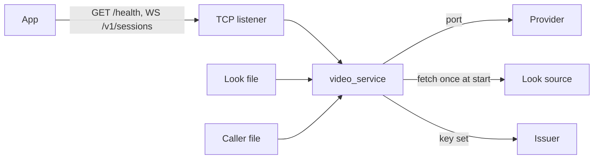

# Architecture

Audience: a developer or reviewer who needs the shape of the video service and
what it trusts.

## Purpose

One process runs one provider, a model that turns a decoded picture and sentence
audio into video, and offers the looks the operator's look file names. An app opens
a session on a look and the service plays the app's sentences on the provider's
frame clock; the media path to viewers is not built yet.
[`README.md`](../README.md) starts it, [`wire.md`](wire.md) holds the wire.
Providers sit behind one narrow port, so a new model never touches the service's
code. The service is built after speech: the same layout, tooling and wire
conventions, with media as the part that differs.

## Context

## Building blocks

- `src/video_service`: the one process. `__main__.py` binds the listener, serves
  health at once, loads on a daemon thread and drains on a stop; `app.py` holds the
  routes and `refusals.py` the HTTP form of a refusal; `session_route.py` refuses
  or accepts a session upgrade and `session.py` is one session's state machine;
  `callers.py` proves the two tokens; `runtime.py` holds the provider, the looks,
  the one readiness they share and the places of the open sessions; `looks.py`
  reads the look file and fetches, checks and decodes an image; `providers.py` is
  the closed catalogue `VIDEO_PROVIDER` picks from; `config.py` reads the settings
  and the caller file; `card.py` reads the card's memory in use.
- `packages/client` (`overnightworks-video-client`): the one owner of the wire's
  types (health, refusals, the session's events) and the bounded health fetch. The
  service and its callers import them.
- `providers/provider-contract`: the port. A provider reports what it plays and
  draws when it starts, prepares each look from a decoded image and opens a session
  on a look, which takes sentence audio and returns frames; the service fetches,
  checks and decodes every image, so a provider never touches the network or an
  untrusted file, and it paces the frames, so a provider never keeps time.
- `providers/fake`: a provider that holds no model. It draws blank frames on the
  audio's timeline and serves the service's tests and a run from source; it is a
  development dependency no image installs.

## Looks

The look file maps a name to an image `{url, sha256}`. At start, after the
provider started, each look runs these checks in order and stops at the first that
fails: the URL lies under an allowed source and its path is plain; the fetch
succeeds without a redirect; the body is within the byte cap; its sha256 is the
file's; its header says no more than the pixel cap; it decodes as PNG, JPEG or
WebP; the provider prepares it. A look that fails stays not ready, logged as
`look_preparation.ended` with a closed `reason`, and the others serve. A provider
that fails to start leaves every look not ready and fetches none.

Nothing is fetched after the start: a look's readiness is fixed when the start
ends. The service keeps no image; what a provider prepares stays inside it.

## Sessions

`runtime.open_session` gives a place, or the refusal in the wire's order, and the
route accepts the upgrade on it. `session.py` then runs three tasks and ends with
the first that ends: the receive loop (events and audio in, queue and clear), the
player (the queued sentences, one at a time, on the frame clock) and the drain
watcher. The frame clock is the audio's: a frame is due one frame period after the
one before, a chunk of audio the client sent late restarts it, and a frame produced more than
`VIDEO_MAX_LAG_MS` after its time ends the session `unavailable`.

Every call into the provider's session runs on a daemon thread of the session's own,
so the provider is never entered twice and a call that never returns holds back
neither the session's end nor the process's exit: a call not back when its frame is
`VIDEO_MAX_LAG_MS` late, or a call outside the audio's clock (the first idle frame, the
return to idle after a clear) not back within `VIDEO_MAX_LAG_MS`, ends the session
`unavailable`, and the session gives up its
place once the close of the provider session has taken that long. A clear lets the call in flight
finish before it asks the provider to return to idle. A sentence's `started`, `stopped`
and `cleared` are sent under one lock that also decides whether the sentence was
dropped, so no event follows its `cleared`.

## Failure isolation

A failed look makes that look not ready; a failed provider makes every look not
ready while health keeps answering; a provider that raises something other than
`ProviderFailedError`, or a listener that cannot bind, ends the process with a
nonzero exit. A provider that fails inside a session ends that session
`unavailable` and no other.

## Trust

- The look file and `VIDEO_LOOK_SOURCES` are the operator's. The look source is
  not trusted: its bytes are bounded input (size, digest, format, pixels) and a
  redirect is never followed, so an allowed host cannot send the service to
  another.
- The caller file is the operator's. A session needs two tokens from the configured
  issuer for the service's own audience, so a token meant for another service is
  refused; the person must be in exactly the service group and the app's group, and
  the app must be registered. The issuer's keys are fetched over https on demand;
  an issuer that cannot be reached refuses every session `unavailable`.
- `GET /health` needs no token and reveals the offered look names, the provider's
  name and the card's memory in use.
- Bounded input from a caller: event JSON (closed types, bounded strings, at most
  64 KiB), PCM at a rate from a closed set, queued audio capped per session, the
  open sessions capped. A caller that breaks a bound ends its own session.
- Egress: the service reaches the look sources at start and the issuer's key set
  when it checks tokens, and nothing else.
- Logs carry closed codes and look names, never a URL, an image, a token, an ICE
  credential or a setting's value. A session's lines join the trace its client
  events carry.

## Delivery

CI runs lint, format and the tests with branch coverage over the service, the
client, the port and the fake provider, then the quality gate. The release
publishes the client distribution at a tag by Git pin
([README](../README.md#release)). No image exists yet.

## Proofs

Behaviour tests drive the HTTP and WebSocket boundary of the real app over a
runtime composed with the fake provider, a real look source on a loopback port and
a throwaway issuer that signs real tokens; the process tests start `main` and stop
it with a signal, and `serve` under a real server with a WebSocket client for the
drain. The client's tests drive `fetch_health` against a raw listener and parse the
session's events.
